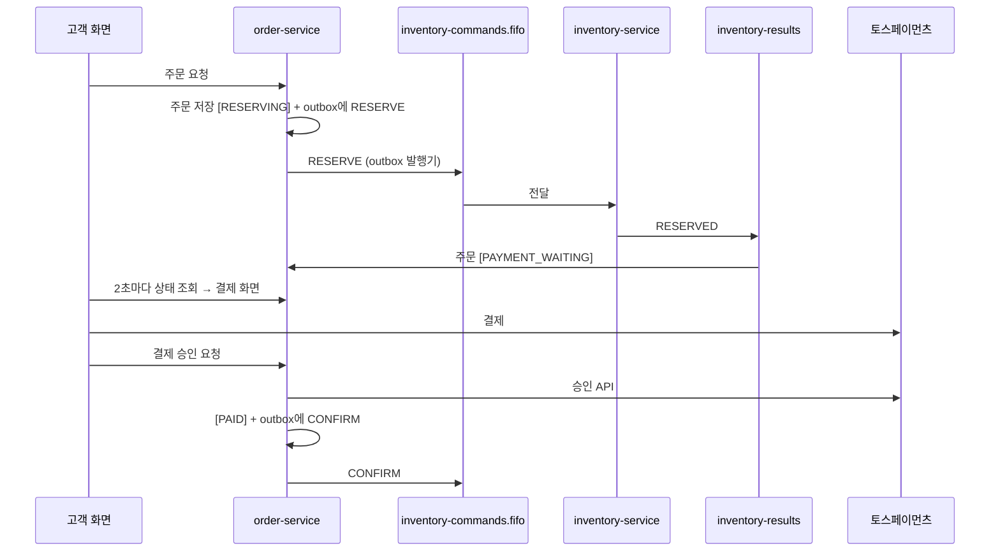

# order-service

> FreshLink의 **주문과 결제**를 다루는 서비스. 주문을 만들고, 재고 예약 → 결제 → 확정으로 이어지는 흐름(Saga)을 이끌며, 중간에 실패하면 잡아 둔 재고를 돌려놓는다.

| 항목 | 내용 |
| --- | --- |
| 담당 | 김경우 |
| 관련 기능 ID | U-21 주문 생성, U-22 결제, U-23 재고 부족 거절, U-31 주문 상태, S-50 신규 주문 목록, E-02 주문 Saga |
| 기술 | Java 21, Spring Boot 3, Spring Data JPA, Spring Cloud AWS (SQS), ShedLock, 토스페이먼츠 테스트 키, MySQL |
| DB | RDS `freshlink-mysql`의 `orders` 스키마 (DB 사용자 `order_app`) |
| 배포 | GitHub Actions → ECR `freshlink/order-service` → ArgoCD → EKS (파드 2개) |

---

## 1. FreshLink는 무엇인가

편의점 점주와 고객이 **같은 재고 데이터**를 보는 서비스다. 고객이 결제하면 점주 화면의 재고가 정확하게 줄고, 유통기한이 지난 상품은 고객에게 팔리지 않는다. 전체 소개는 [Organization README](https://github.com/sesac-freshlink)를 참고한다.

## 2. 주문 흐름 (Saga)

**Saga**는 여러 서비스에 걸친 작업을 단계별로 진행하고, 중간에 실패하면 앞 단계를 되돌리는 방식이다. 이 서비스는 재고를 직접 건드리지 않고, [inventory-service](https://github.com/sesac-freshlink/inventory-service)에 **쪽지(SQS 메시지)** 로 부탁한다.



### 실패하는 세 가지 경우

| 경우 | 하는 일 | 주문 상태 |
| --- | --- | --- |
| 재고 부족 | RESERVE_FAILED 쪽지를 받는다 | `OUT_OF_STOCK` |
| 결제 실패 | RELEASE 쪽지를 보내 예약 재고를 돌려놓는다 | `PAYMENT_FAILED` |
| 10분 안에 결제 안 함 | 스케줄러가 오래된 결제 대기 주문에 RELEASE를 보낸다 | `EXPIRED` |

주문 상태: `RESERVING` → `PAYMENT_WAITING` → `PAID` (실패 시 `OUT_OF_STOCK` / `PAYMENT_FAILED` / `EXPIRED`)

## 3. 기능과 API

| ID | 기능 | API | 완료 기준 |
| --- | --- | --- | --- |
| U-21 | 주문 생성 | `POST /orders` | [예약 중]으로 저장되고 RESERVE 쪽지가 나간다 |
| U-22 | 결제 | `POST /orders/{id}/payment/confirm` | 토스 테스트 결제 승인 시 [결제 완료] + CONFIRM |
| U-23 | 재고 부족 거절 | 내부 로직 | [재고 부족으로 취소]와 안내 문구 |
| U-31 | 주문 상태 | `GET /orders/{id}` | 예약 중 → 결제 대기 → 결제 완료(또는 취소) |
| S-50 | 신규 주문 목록 | `GET /owner/orders` | 결제 완료 주문이 최신순 |
| E-02 | 주문 Saga | 쪽지 흐름 | 결제 실패·10분 미결제 시 예약 재고가 돌아온다 |

## 4. 데이터 모델

| 표 | 주요 컬럼 |
| --- | --- |
| `orders` | id, customer_id, store_id, product_id, quantity, amount, status, created_at |
| `payment` | id, order_id, payment_key, amount, status |
| `outbox`, `processed_message` | [common](https://github.com/sesac-freshlink/common) 모듈이 쓰는 표 |

`order`는 SQL 예약어라 표·스키마 이름을 `orders`로 쓴다.

## 5. 폴더 구조

```
order-service/
├── src/main/java/com/freshlink/order/
│   ├── config/      # SQS, ShedLock, Swagger, 토스 클라이언트 설정
│   ├── order/       # 주문 엔티티, 주문 API
│   ├── payment/     # 토스 결제 승인
│   ├── saga/        # 상태 전이, 실패 시 보상(RELEASE)
│   ├── messaging/   # inventory-results 리스너
│   └── scheduler/   # 10분 미결제 주문 정리
├── src/main/resources/application.yml
└── src/test/java/com/freshlink/order/
```

## 6. 로컬에서 실행하기

> 아직 뼈대만 있는 상태다. 첫 작업으로 [Spring Initializr](https://start.spring.io)에서 Gradle·Java 21·Web·JPA·MySQL Driver로 프로젝트를 만들고, Spring Cloud AWS SQS와 `com.freshlink:common` 의존성을 추가한다.

1. [local-dev](https://github.com/sesac-freshlink/local-dev)에서 `docker compose up -d`
2. inventory-service를 띄운다 (예약 결과를 받으려면 필요)
3. 이 레포에서

```bash
export DB_PASSWORD=<local-dev의 order_app 비밀번호>
export TOSS_SECRET_KEY=<토스페이먼츠 테스트 시크릿 키>
./gradlew bootRun --args='--spring.profiles.active=local'
```

토스 키는 절대 커밋하지 않는다. 운영에서는 Organization Secret → Kubernetes Secret으로 넣는다.

## 7. 브랜치와 기여

- `main`(배포) ← `dev`(통합, 기본 브랜치) ← `feat/<기능ID>-<설명>` (예: `feat/U-21-create-order`)
- 커밋·PR 제목: `feat(U-21): 주문 생성 API 추가`
- 쪽지 형식이 바뀌는 PR은 `message-spec` 라벨을 달고 이태우에게도 리뷰를 받는다.

자세한 규칙은 [.github 레포](https://github.com/sesac-freshlink/.github)를 참고한다.
