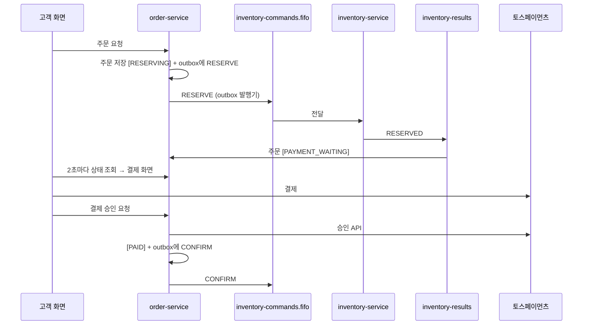

# order-service

> FreshLink의 **주문과 결제**를 다루는 서비스. 주문을 만들고, 재고 예약 → 결제 → 확정으로 이어지는 흐름(Saga)을 이끌며, 중간에 실패하면 잡아 둔 재고를 돌려놓는다.

| 항목 | 내용 |
| --- | --- |
| 담당 | 김경우 |
| 관련 기능 ID | U-21 주문 생성, U-22 결제, U-23 재고 부족 거절, U-31 주문 상태, S-50 신규 주문 목록, E-02 주문 Saga |
| 기술 | Java 21, Spring Boot 4.0.x, Spring Data JPA, Flyway(테이블 마이그레이션), Spring Cloud AWS 4.x (SQS), ShedLock, 토스페이먼츠 테스트 키, MySQL |
| 관측성 | Actuator·Micrometer → Prometheus (앱 포트의 `/actuator/prometheus`, 관리 포트를 따로 두지 않는다. 모든 서비스가 8080) · Micrometer Tracing → Zipkin · JSON 로그(traceId 포함) → Alloy → Loki ([gitops/platform/observability](https://github.com/sesac-freshlink/gitops/tree/main/platform/observability)) |
| DB | RDS `freshlink-mysql`의 `orders` 스키마 (DB 사용자 `order_app`) |
| 배포 | GitHub Actions → ECR `freshlink/order-service` → ArgoCD → EKS (파드 2개) |

---

## 1. FreshLink는 무엇인가

편의점 점주와 고객이 **같은 재고 데이터**를 보는 서비스다. 고객이 결제하면 점주 화면의 재고가 정확하게 줄고, 유통기한이 지난 상품은 고객에게 팔리지 않는다. 전체 소개는 [Organization README](https://github.com/sesac-freshlink)를 참고한다.

## 2. 주문 흐름 (Saga)

**Saga**는 여러 서비스에 걸친 작업을 단계별로 진행하고, 중간에 실패하면 앞 단계를 되돌리는 방식이다. 이 서비스는 재고를 직접 건드리지 않고, [inventory-service](https://github.com/sesac-freshlink/inventory-service)에 **쪽지(SQS 메시지)** 로 부탁한다.



### 실패하는 세 가지 경우

| 경우 | 하는 일 | 주문 상태 |
| --- | --- | --- |
| 재고 부족 | RESERVE_FAILED 쪽지를 받는다 | `OUT_OF_STOCK` |
| 결제 실패 | RELEASE 쪽지를 보내 예약 재고를 돌려놓는다 | `PAYMENT_FAILED` |
| 10분 안에 결제 안 함 | 스케줄러가 오래된 결제 대기 주문에 RELEASE를 보낸다 | `EXPIRED` |

주문 상태: `RESERVING` → `PAYMENT_WAITING` → `PAYMENT_APPROVING` → `PAID` (실패 시 `OUT_OF_STOCK` / `PAYMENT_FAILED` / `EXPIRED`)

## 3. 기능과 API

| ID | 기능 | API | 완료 기준 |
| --- | --- | --- | --- |
| U-21 | 주문 생성 | `POST /orders` (헤더 `Idempotency-Key`) | [예약 중]으로 저장되고 RESERVE 쪽지가 나간다. 새 주문 201, 같은 키·같은 내용 200, 같은 키·다른 내용 409 |
| U-22 | 결제 | `POST /orders/{id}/payment/confirm` | 토스 테스트 결제 승인 시 [결제 완료] + CONFIRM |
| U-23 | 재고 부족 거절 | 내부 로직 | [재고 부족으로 취소]와 안내 문구 |
| U-31 | 주문 상태 | `GET /orders/{id}` | 주문 확인 중 → 결제 대기 → 결제 완료(또는 취소). 고객 화면에는 "예약"이라는 말을 쓰지 않는다 |
| S-50 | 신규 주문 목록 | `GET /owner/orders` | 결제 완료 주문이 최신순 |
| E-02 | 주문 Saga | 쪽지 흐름 | 결제 실패·10분 미결제 시 예약 재고가 돌아온다 |

- 경로는 서비스 안 경로다. 브라우저는 `/api/orders`로 부르고 gateway가 `/api`를 뗀다.
- 구현된 것: U-21 주문 생성(OR-01), U-31 주문 조회(OR-02, 본인 주문만, 시각은 +09:00), S-50 점주 신규 주문 목록(OR-04, `X-Store-Id` 점포의 `PAID` 주문을 결제 최신순으로), U-22 결제 승인(OR-03, 토스 승인 → `PAID` + CONFIRM / 확정 실패 → `PAYMENT_FAILED` + RELEASE / 결과 불명 → `PAYMENT_APPROVING` 유지), E-02 결제 시간 만료(1분마다, `PAYMENT_WAITING`이고 마감이 지난 주문 → `EXPIRED` + RELEASE(EXPIRED), ShedLock으로 파드 한 곳만), 운영 API OP-01 결제 결과 수동 확인(`POST /ops/orders/{id}/payment-sync`, 토스 결제 조회로 `PAYMENT_APPROVING` 정리)·OP-02 멈춘 주문 수동 종료(`POST /ops/orders/{id}/close`, `RESERVING` → `EXPIRED` + RELEASE(EXPIRED)). `/ops/**`는 gateway 라우트가 없어 `kubectl port-forward`로만 부른다, U-23 재고 확보 결과 반영(`inventory-results` 리스너: `RESERVED` → `PAYMENT_WAITING`, `RESERVE_FAILED` → `OUT_OF_STOCK`). 요청·응답·오류 코드는 order-service API 명세를 따른다.
- 결과 쪽지는 `messageId`로 한 번만 반영하고(processed_message), 주문이 `RESERVING`일 때만 바꾼다. 다른 상태면 무시하고 로그만 남긴다. 주문과 맞지 않는 `RESERVED`(점포·상품·수량, lot 합계)나 없는 주문의 결과는 예외를 던져 SQS가 다시 보내게 하고, 계속 실패하면 DLQ로 간다.

## 4. 데이터 모델

| 표 | 주요 컬럼 |
| --- | --- |
| `orders` | id, order_no, customer_id, request_id, store_id, store_name, product_id, product_name, quantity, unit_price, amount, status, failure_reason, available_quantity, payment_waiting_at, payment_expires_at, paid_at, closed_at, created_at, updated_at |
| `order_lot` | id, order_id, lot_id, quantity, expiry_at (RESERVED로 받은 lot) |
| `payment` | id, order_id, payment_key, toss_idempotency_key, amount, status(APPROVING/DONE/FAILED), toss_status, method, error_code, error_message, approved_at |
| `shedlock` | 파드 2개 중 한 곳만 스케줄러·Outbox 발행기를 돌리는 잠금 |
| `outbox`, `processed_message` | [common](https://github.com/sesac-freshlink/common) 모듈이 쓰는 표 |

`order`는 SQL 예약어라 표·스키마 이름을 `orders`로 쓴다. 표는 Flyway로 만든다(V1 주문·lot·결제·shedlock, V2 outbox·processed_message).

시각 칼럼은 한국 시각 벽시계로 저장한다(`hibernate.timezone.default_storage: NORMALIZE` + `jdbc.time_zone: Asia/Seoul`). 응답은 `+09:00`이다. common이 쓰는 `outbox`·`processed_message`의 시각은 DB의 `NOW(6)`이라 RDS 세션 시간대(UTC)를 따른다(비교에 쓰지 않아 동작에는 영향이 없다).

## 5. 폴더 구조

```
order-service/
├── build.gradle                       # Boot 4.0.8, Web·JPA·Validation·Actuator·MySQL·Flyway·Swagger·SQS·ShedLock·Testcontainers + common 0.2.0
├── src/main/java/com/freshlink/order/
│   ├── OrderServiceApplication.java
│   ├── common/                        # 도메인과 상관없는 공통 코드
│   │   ├── config/      # ShedLock(LockConfig), JPA Auditing, 시계(ClockConfig), 토스 클라이언트, 스케줄링(SchedulingConfig)
│   │   ├── error/       # OrderErrorCode(enum), GlobalExceptionHandler
│   │   ├── messaging/   # inventory-results 리스너(InventoryResultListener)
│   │   └── web/         # gateway가 넘기는 헤더 이름과 역할 확인(AuthHeaders, 그룹이 여럿이면 쉼표로 온다)
│   └── domain/                        # 도메인별 엔티티·서비스·API
│       ├── order/       # 주문·주문 lot 엔티티, 주문 생성·조회·점주 목록 API, 예약 결과 반영(ReservationResultHandler),
│       │                #   결제 시간 만료(OrderExpiryService), 운영 API(OpsOrderController: OP-01·OP-02, OrderCloseService)
│       ├── payment/     # 토스 결제 승인(PaymentService), 결제 결과 수동 확인(PaymentSyncService), 결과 반영 공통(PaymentResultWriter),
│       │                #   Payment 엔티티, toss/ 클라이언트(승인·조회)·오류 코드 분류
│       ├── saga/        # 비어 있다. 상태 전이는 Order 메서드, 보상(RELEASE)은 PaymentResultWriter·OrderExpiryService·OrderCloseService가 한다
│       └── scheduler/   # 10분 미결제 주문 정리 (OrderExpiryScheduler, 잠금 order-expiry)
├── src/main/resources/
│   ├── application.yml                # 공통. 값은 환경 변수
│   ├── application-dev.yml            # 로그 레벨만 다름
│   ├── application-prod.yml
│   └── db/migration/                  # Flyway SQL. V1__init.sql 부터
└── src/test/java/com/freshlink/order/
    ├── common/error/GlobalExceptionHandlerTest.java   # 오류 응답 모양 (DB 없이)
    ├── domain/order/                  # 엔티티·서비스 단위, 컨트롤러(@WebMvcTest), Testcontainers 통합 테스트 (SQS는 목)
    ├── domain/payment/                # 결제 승인·수동 확인 통합 테스트(토스 클라이언트 목), toss/ 클라이언트(가짜 서버)·오류 코드 분류
    └── domain/scheduler/              # 만료 스케줄러 잠금
```

## 5-1. 오류 처리

규칙은 .github 레포 `docs/백엔드-공통-규칙.md` 6장. 응답 모양은 common 라이브러리, 오류 목록과 핸들러는 이 레포에 있다.

| 할 일 | 방법 |
| --- | --- |
| 업무 오류 던지기 | `throw new BusinessException(OrderErrorCode.ORDER_NOT_FOUND);` 한 줄 |
| 오류 코드 추가 | `common/error/OrderErrorCode`에 `XXX(404, "메시지")` 한 줄. 핸들러는 안 건드린다 |
| 응답 모양 | 항상 `{"code": "ORDER_NOT_FOUND", "message": "주문이 없습니다", "traceId": "4bf92f3577b34da6"}`. `@Valid` 실패는 400 `VALIDATION_ERROR`(message에 필드별 사유), 없는 경로는 404 `NOT_FOUND`, 그 밖은 500 `INTERNAL_ERROR`(원인은 로그에만) |

## 6. dev 환경에서 실행하기

> Boot 4.0.8, Gradle 9.8.1, Java 21. `com.freshlink:common` 0.2.0(Outbox 발행기·멱등 처리)과 Spring Cloud AWS SQS를 쓴다. RESERVE 쪽지는 `app.queue.commands`(= `${QUEUE_PREFIX}inventory-commands.fifo`)로 나가고, 결과는 `app.queue.results`(= `${QUEUE_PREFIX}inventory-results`)에서 받는다. 큐가 없으면 앱이 뜨지 않는다(`queue-not-found-strategy: fail`, 큐는 인프라가 만든다).
>
> **DB 없이 IntelliJ에서 띄우기:** Docker Desktop을 켜고 `src/test/java/com/freshlink/order/TestOrderServiceApplication`을 Run 한다. DB를 따로 띄우지 않아도 MySQL 8.4 이미지를 받아 컨테이너로 띄우고 자동으로 붙는다 (Testcontainers 라이브러리 기능). main 소스 변경사항이 그대로 반영된다. AWS 큐에 붙지 않고 띄우려면 실행 설정에 `--spring.cloud.aws.sqs.listener.auto-startup=false`를 준다(결과 쪽지를 받지 않는다). RDS가 준비되면 아래처럼 `DB_URL` 환경 변수만 주고 `OrderServiceApplication`으로 실행한다.

개발할 때도 AWS dev 환경의 RDS·SQS·Cognito를 그대로 쓴다. AWS 로그인, DB 포트 포워딩(SSM), 개인 큐 설정은 [개발 환경 접속 가이드](https://github.com/sesac-freshlink/.github/blob/main/docs/개발환경-접속.md)를 따른다.

```bash
export SPRING_PROFILES_ACTIVE=dev
export DB_URL=jdbc:mysql://127.0.0.1:3306/orders      # SSM 포트 포워딩으로 연결한 dev RDS
export DB_PASSWORD=<dev Secrets Manager의 order_app 비밀번호>
export TOSS_SECRET_KEY=<토스페이먼츠 테스트 시크릿 키>
export QUEUE_PREFIX=dev-<내 이름>-                     # 개인 큐
./gradlew bootRun
```

토스 키는 절대 커밋하지 않는다. `TOSS_SECRET_KEY`가 비어 있으면 앱은 뜨지만 결제 승인은 주문을 바꾸지 않고 500으로 거절한다. 토스 호출 타임아웃은 연결 3초·응답 15초다. dev·prod 클러스터에서는 Secrets Manager → External Secrets로 넣는다.

## 7. 브랜치와 기여

- `main`(배포) ← `dev`(통합, 기본 브랜치) ← `feat/<기능ID>-<설명>` (예: `feat/U-21-create-order`)
- 커밋·PR 제목: `feat(U-21): 주문 생성 API 추가`
- 쪽지 형식이 바뀌는 PR은 `message-spec` 라벨을 달고 합치기 전에 이태우에게 꼭 알린다.

자세한 규칙은 [.github 레포](https://github.com/sesac-freshlink/.github)를 참고한다.
